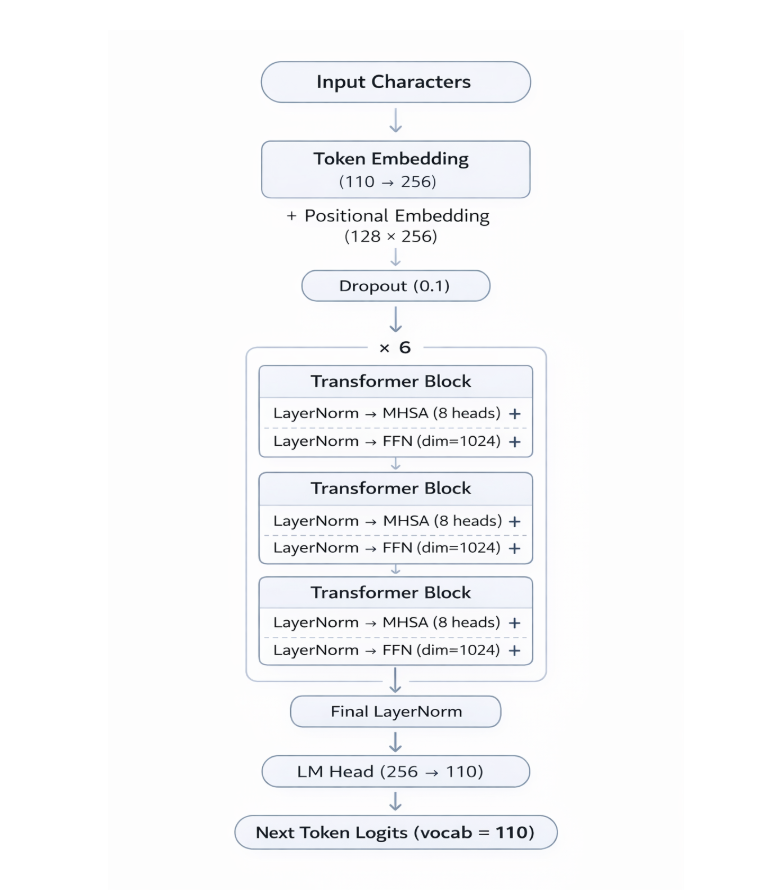
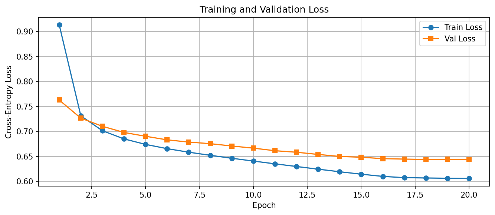

# GPT-Style LLM from Scratch

> A decoder-only Transformer (≈4.8M parameters) written from scratch in PyTorch, with no pre-trained weights or tokenizers, trained on TinyStories to generate short stories character by character.


**▶ [Live demo](https://iamsavitha.github.io/GPT-Style-LLM-from-Scratch/)**: generate stories with the trained model, running entirely in your browser (ONNX Runtime Web, exported by GitHub Actions).

## Highlights

- **Every component written by hand:** token and positional embeddings, causal multi-head self-attention (8 heads), GELU feed-forward blocks, pre-norm residuals and an LM head. 6 layers, d_model 256, context length 128.
- **Training recipe:** AdamW with weight decay, linear warmup + cosine LR decay (3e-3 → 3e-4), gradient clipping, and 20 epochs on 100K stories.
- **Results:** final validation loss **0.644** (≈ **1.90** per-character perplexity), with a train/validation gap of only 0.04.
- **Sampling analysis:** generations at temperature 0, 0.8 and 1.2, with documented failure modes (repetition, coherence drift, hallucination).

<p>
  
  
</p>

---

## Project Overview

This project explores how **autoregressive language models** work at a fundamental level by building a GPT-style architecture **without using any pre-trained models or embeddings**.

The model learns to predict the next character in a sequence and generates text by sampling from learned probability distributions.

---

## Objectives

- Build a **GPT-style Transformer** from scratch  
- Understand **self-attention and sequence modeling**
- Train on a real dataset (**TinyStories**)  
- Generate **coherent short stories**
- Analyze **failure modes in generation**

---

## Model Architecture

The model follows a **decoder-only Transformer architecture** consisting of:

- Token + Positional Embeddings  
- 6 Transformer Blocks  
- Multi-Head Self-Attention (8 heads)  
- Feed-Forward Neural Network (GELU activation)  
- Layer Normalization + Residual Connections  
- Language Modeling Head  

### Key Parameters

| Parameter | Value |
|----------|------|
| Embedding Dimension | 256 |
| Attention Heads | 8 |
| Transformer Layers | 6 |
| Sequence Length | 128 |
| FFN Dimension | 1024 |
| Dropout | 0.1 |
| Total Parameters | ~4.8M |

---

## Dataset

- **TinyStories Dataset**
- ~2 million short synthetic stories

### Split

- Train: 100,000 stories  
- Validation: 10,000 stories  

### Tokenization

- Character-level tokenization  
- Vocabulary size: **110 characters**

---

## Training Setup

- Optimizer: **AdamW**
- Learning Rate: `3e-3`
- Weight Decay: `1e-2`
- Batch Size: `128`
- Epochs: `20`
- Gradient Clipping: `1.0`

### Learning Rate Schedule

- Linear warmup (first 200 steps)
- Cosine decay to minimum `3e-4`

---

## Results

| Metric | Value |
|--------|------|
| Final Training Loss | 0.6057 |
| Final Validation Loss | 0.6438 |

- Stable convergence across 20 epochs  
- Minimal overfitting (small train-val gap)

---

## Sample Generations

### Low Temperature (T = 0)
- Fluent and coherent stories  
- Deterministic outputs  

### Medium Temperature (T = 0.8)
- More creative and diverse outputs  
- Mostly coherent  

### High Temperature (T = 1.2)
- Increased randomness  
- Occasional incoherence and nonsense  

---

## Failure Analysis

### 1. Repetition
She tried to pull it out, but it was too hard...
(repeats endlessly)

### 2. Loss of Coherence
- Sudden topic or character shifts  

### 3. Hallucination
- Non-existent words (e.g., *“ductors”, “wugged”*)

---

## Strengths

- Stable training without divergence  
- Generates grammatically correct sentences  
- Efficient architecture with ~4.8M parameters  
- Good generalization  

---

## Limitations

- Character-level tokenization limits semantic understanding  
- Context window limited to 128 tokens  
- Domain-specific (story generation only)  

---

## Tech Stack

- Python  
- PyTorch  
- NumPy  
- Matplotlib  

---

## Project Structure

```
GPT-Style-LLM-from-Scratch/
├── Code_file.ipynb          # data prep, model, training loop, generation
├── Architecture.png         # model diagram
├── output_files/
│   └── loss_curves.png      # train / validation loss
├── model.pth                # trained weights
└── tinygpt_checkpoint.pt    # full training checkpoint
```

---

## How to Run

```bash
pip install torch numpy matplotlib datasets jupyter
jupyter notebook Code_file.ipynb
```

Run the cells in order: load TinyStories → build the character vocabulary → train → generate. To skip training, load `model.pth` and run only the generation cells.

Local web UI: `pip install -r demo/requirements.txt && python demo/app.py` (Gradio). The browser demo is built by `demo/export_onnx.py` + `.github/workflows/pages.yml`.

---

## References

- Vaswani et al., *Attention is All You Need* (2017)  
- TinyStories Dataset (2023)  
- GPT Architecture (OpenAI)

---

## Key Learnings

- Understanding **self-attention from first principles**
- Importance of **tokenization choices**
- Trade-offs between **coherence vs creativity (temperature)**
- Handling **training stability in transformers**

---

## Future Improvements

- Switch to **subword tokenization (BPE)**
- Increase **context window**
- Add **attention visualization**
- Train on **larger datasets**

---

## Author

**Keith Rajesh Gonslaves**

**Savitha Vijayarangan**  
